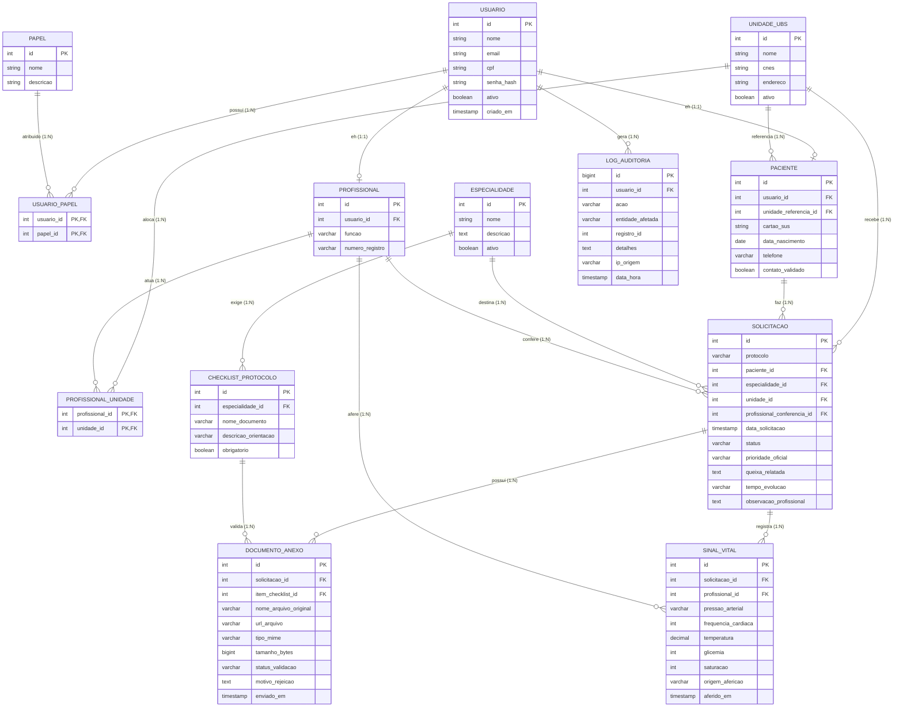

## Sistema de Pré-Triagem e Qualificação Documental para Encaminhamentos nas UBSs de Americana

### 1. Problemática: 
Na rede pública de saúde (SUS), a alta demanda por consultas e procedimentos especializados gera longas filas de espera e sobrecarga nas Unidades Básicas de Saúde (UBSs). Em Americana (SP), dados do Relatório Anual de Gestão da Saúde (2025) (https://www.saudeamericana.com.br/v2/wp-content/uploads/planejamento/gestao25.pdf) e indicadores demográficos evidenciam gargalos estruturais que pressionam diretamente a Atenção Primária:

- Déficit de Comunicação Digital nas UBSs (0%): Embora o município disponha de totens de autoatendimento e ferramentas de consulta passiva no portal Conecta Saúde (como o Tá Marcado e o Aqui Tem Remédio), a meta específica de implantar uma ferramenta de comunicação online direta entre as UBSs e a população teve 0% de execução em 2025. Sem esse canal, o cidadão precisa retornar presencialmente às unidades apenas para saber se houve pendência em seu pedido.

- Protocolos de Encaminhamento Não Padronizados (70%): A elaboração de protocolos integrados entre UBSs, especialidades e hospital atingiu 70% da meta, fazendo com que solicitações sem exames prévios ou com documentação ilegível cheguem à Central de Regulação, gerando devoluções, perda de prazos e retrabalho.

- Combate ao Absenteísmo Incompleto (75%): A atualização dos sistemas de informação da Central de Regulação para reduzir faltas em consultas e exames atingiu 75% da meta, demonstrando a necessidade de validar contatos e qualificar os dados dos pacientes ainda na porta de entrada.

Embora o município também enfrente desafios nas Unidades de Pronto Atendimento (UPAs) e na rede hospitalar, este projeto delimita seu escopo exclusivamente às Unidades Básicas de Saúde (UBSs) de Americana, atuando na qualificação documental e pré-triagem de encaminhamentos especializados para evitar o represamento na Central de Regulação e o agravamento clínico dos pacientes.

### 2. Introdução: 
Este documento especifica o planejamento e a arquitetura para o desenvolvimento de uma plataforma web e mobile de pré-triagem estruturada, registro de sinais vitais de acolhimento e qualificação documental para encaminhamentos de especialidades nas UBSs de Americana.

O sistema atua como uma etapa preparatória antes da inserção do pedido nos sistemas oficiais de regulação (Conecta Saúde / SISREG), garantindo que toda solicitação chegue completa, legível, com contato validado e com os pré-requisitos clínicos e administrativos conferidos — sem realizar diagnóstico médico ou classificação de risco autônoma, respeitando as atribuições privativas dos profissionais de saúde.

A solução será desenvolvida utilizando Flutter para a interface mobile do cidadão, Angular para o painel web das UBSs, Java com Spring Boot no back-end e PostgreSQL como banco de dados relacional.

### 3. Relação com o projeto:
O projeto atua diretamente nos percentuais não concluídos do planejamento municipal de saúde de Americana: preenche a lacuna de comunicação online nas UBSs, operacionaliza na prática os protocolos de encaminhamento por meio de checklists digitais obrigatórios e apoia a redução do absenteísmo ao garantir que cada solicitação enviada à Regulação contenha telefone/WhatsApp validado, sinais vitais de acolhimento e documentação completa. Além disso, considera o perfil demográfico local (19,5% de idosos) ao priorizar interfaces acessíveis e o modo de pré-triagem assistida por recepcionistas e Agentes Comunitários de Saúde (ACS).

### 4. Requisitos
#### 4.1 Requisitos Funcionais: 
- RF01 - Identificação do Cidadão: Permitir acesso via CPF ou Cartão Nacional de Saúde (CNS) combinado com a data de nascimento, mantendo compatibilidade com o padrão de entrada já utilizado pelo cidadão no Conecta Saúde de Americana.

- RF02 - Formulário Guiado de Pré-Triagem: Apresentar formulários adaptativos conforme a especialidade solicitada (priorizando especialidades de alta demanda no município, como Ortopedia e Gastroenterologia/Aparelho Digestivo), coletando queixa principal, tempo de evolução dos sintomas e histórico básico em linguagem acessível, sem caráter diagnóstico.

- RF03 - Checklist Documental Obrigatório: Exigir dinamicamente os anexos previstos no protocolo de cada especialidade (ex: foto legível do pedido médico/encaminhamento, documento pessoal e exames laboratoriais ou de imagem prévios), bloqueando o envio de solicitações incompletas.

- RF04 - Registro de Sinais Vitais no Acolhimento (UBS): Disponibilizar interface para que a equipe de enfermagem registre valores aferidos presencialmente na UBS (pressão arterial, temperatura, glicemia capilar e saturação) vinculados à solicitação, diferenciando-os claramente de eventuais medições domiciliares auto-relatadas pelo paciente.

- RF05 - Painel de Conferência Documental (UBS): Permitir que profissionais da Atenção Básica revisem a legibilidade dos anexos, validem o cumprimento do checklist, registrem a prioridade clínica oficial (definida pelo profissional) e liberem o pedido para a fila de regulação.

- RF06 - Devolução Orientada por Pendência: Permitir que o servidor da UBS devolva uma solicitação apontando exatamente qual documento está ilegível, vencido ou ausente, notificando o cidadão pelo canal online da unidade para reenvio sem perda do histórico da solicitação.

- RF07 - Pré-Triagem Assistida (Recepção/ACS): Disponibilizar modo simplificado para que recepcionistas ou Agentes Comunitários de Saúde (ACS) realizem o cadastro e a digitalização de documentos para idosos ou pacientes sem acesso digital.

- RF08 - Linha do Tempo, Validação de Contato e Exportação Estruturada: Exigir confirmação de telefone/WhatsApp ativo (apoio ao combate ao absenteísmo), exibir ao cidadão o status atualizado da solicitação (Rascunho, Em Conferência na UBS, Pendência Documental, Apto para Regulação) e gerar um pacote de dados padronizado para lançamento no sistema interno (Conecta Saúde / SISREG). 

#### 4.2 Requisitos Não Funcionais:
- RNF01 - Proteção de Dados e Conformidade (LGPD): Garantir tráfego criptografado (HTTPS/TLS), armazenamento seguro dos documentos anexados e registro de logs auditáveis de acesso e alteração.

- RNF02 - Controle de Acesso por Perfil (RBAC): Restringir funcionalidades conforme o perfil do usuário: Cidadão (envio e acompanhamento próprio), Recepção/ACS (cadastro assistido e anexo de documentos) e Profissional de Saúde (registro de sinais vitais de acolhimento, conferência final e definição de prioridade).

- RNF03 - Usabilidade e Acessibilidade: Garantir interface responsiva, com fontes ampliáveis, alto contraste e linguagem clara para atender o público idoso (19,5% da população) e usuários com baixa familiaridade digital.

- RNF04 - Padronização de Arquivos e Desempenho: Realizar compressão automática de imagens capturadas pela câmera do celular (suportando JPG, PNG e PDF até 5 MB) para garantir carregamento rápido mesmo em redes móveis 3G/4G nas UBSs.

- RNF05 - Stack Tecnológica e Arquitetura MVC: Estruturar a aplicação sob a arquitetura MVC (Model-View-Controller), isolando o domínio e a persistência (Model com entidades JPA/Hibernate e PostgreSQL), o controle de requisições e regras de fluxo (Controller via API REST em Java com Spring Boot) e a camada de visualização (View com painel administrativo web em Angular e aplicativo mobile em Flutter).

### 5. Diagrama de Entidade Relacional

### 6. Casos de Teste

#### 6.1 Casos de Teste Funcionais
| ID | Requisitos | Cenário | Descrição | Resultado Esperado |
| --- | --- | --- | --- | --- |
| CT-01 | RF01, RF02, RF03, RF08 | Submissão de Pré-Triagem e Validação de Checklist | Cidadão acessa com CPF e data de nascimento, confirma telefone/WhatsApp, seleciona especialidade (ex: Ortopedia), preenche queixa/sintomas e tenta enviar sem anexar o exame prévio exigido pelo protocolo. Após bloqueio, anexa o PDF/foto e conclui. | Acesso validado, contato marcado como validado, sistema impede envio sem anexo obrigatório e cria solicitação com status Em Conferência na UBS. |
| CT-02 | RF04, RF07 | Pré-Triagem Assistida e Sinais Vitais no Acolhimento | Recepcionista da UBS cadastra solicitação para paciente idoso sem smartphone. Em seguida, técnico de enfermagem lança Pressão Arterial (140x90 mmHg) e Glicemia (118 mg/dL) com origem Acolhimento UBS. | Solicitação vinculada ao paciente e sinais vitais registrados como aferição oficial da UBS, diferenciados de auto-relatos domiciliares.|
| CT-03 | RF05, RF06 | Conferência Documental e Devolução Orientada | Profissional da UBS abre a solicitação no painel Angular, identifica que a foto do pedido médico está ilegível e devolve marcando exatamente esse item como pendente. | Status muda para Pendência Documental, notificação é enviada ao cidadão pelo canal online da UBS e os dados já preenchidos são preservados. |
| CT-04 | RF05, RF08 | Aprovação na UBS e Geração de Resumo para Regulação | Após reenvio legível pelo cidadão, profissional valida todos os anexos, define a prioridade clínica oficial e aprova a solicitação para regulação. | Status atualizado para Apto para Regulação na linha do tempo do cidadão e pacote estruturado gerado para lançamento no Conecta Saúde / SISREG. |

#### 6.2 Casos de Teste Não Funcionais 
| ID | Requisitos | Escopo | Descrição | Critério | 
| --- | --- | --- | --- | --- | 
| CT-05 | RNF01, RNF02 |Segurança e Controle de Perfis (RBAC)| Tentar acessar o painel de validação clínica e os documentos anexados utilizando um token de perfil Cidadão ou Recepção em endpoints restritos a Profissional de Saúde.| API bloqueia a requisição (HTTP 403 Forbidden), tráfego ocorre via HTTPS e tentativa é registrada no log de auditoria. | 
| CT-06 | RNF03, RNF04, RNF05 | Compressão de Mídia e Acessibilidade Mobile | Realizar upload de uma foto de 8 MB tirada pela câmera de um smartphone em conexão móvel simulada (3G) através do aplicativo Flutter, testando também o aumento de fonte para público idoso.| Imagem é comprimida automaticamente no cliente antes do envio, upload conclui sem falha e interface mantém contraste/legibilidade adequados. | 
